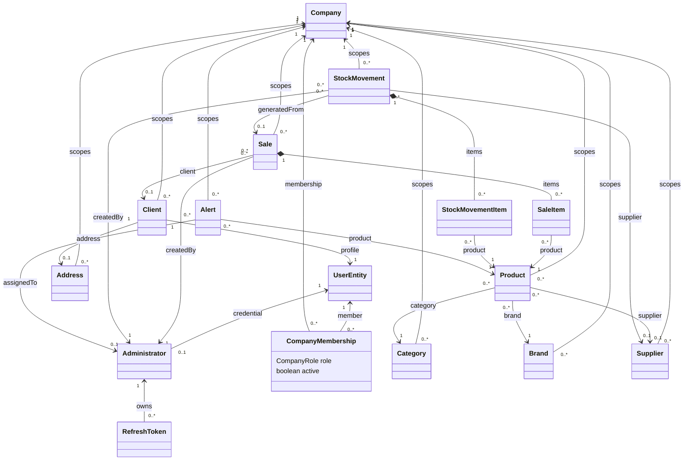

# Modelo de domínio

Este diagrama é uma visão de manutenção das relações principais do backend. Ele prioriza a empresa ativa, segurança e fluxos operacionais; campos e DTOs ficam fora para manter a leitura útil durante o crescimento do sistema.

## Regras de leitura

- `CompanyMembership` é a fonte do papel ativo do usuário na empresa; o JWT carrega `user_id`, `company_id` e `membership_id`.
- Entidades operacionais são sempre delimitadas por `Company`; relações entre empresas devem ser rejeitadas pelos serviços.
- Apenas vendas concluídas originam movimentação de estoque do tipo `SALE`.
- `UserEntity` é compartilhado como identidade, mas clientes e vínculos de empresa são delimitados pela empresa atual.
